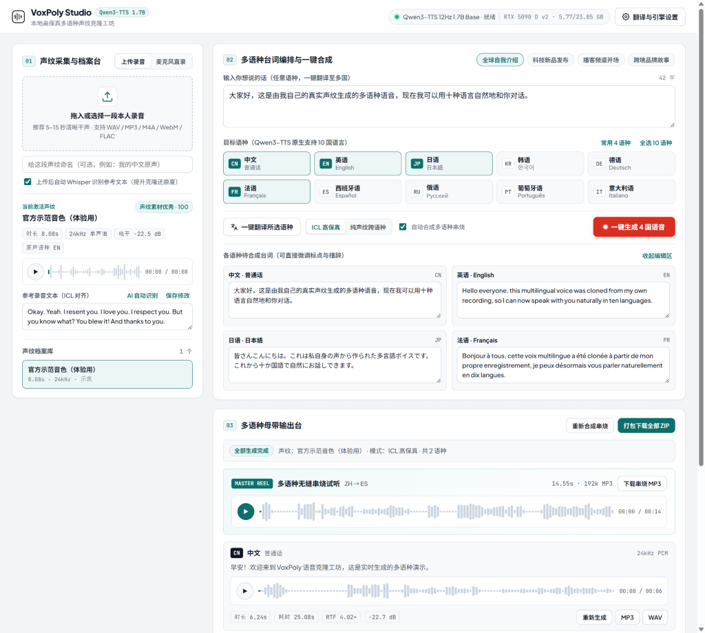

<div align="center">

# 🎙️ VoxPoly Studio V2.0 Pro

**开源一站式多语种声纹克隆、长文播客合成与视频一键译配工作台**

[](./LICENSE)
[](#快速本地部署)
[](#三引擎架构)
[](https://colab.research.google.com/github/zianxu78-ux/voxpoly-studio/blob/main/colab/VoxPoly_Colab.ipynb)

[简体中文](./README.md) · [English](./README_EN.md) · [开源选型与架构报告](./docs/GITHUB_RESEARCH_AND_ARCHITECTURE.md) · [安全与合规](./SECURITY.md)

<br/>



</div>

---

## ✨ 为什么做 VoxPoly Studio？

GitHub 上优秀的开源 TTS 模型很多，但大多数只提供单句调试用的 Gradio Demo。**VoxPoly Studio** 把完整内容生产闭环整合进一个清爽的浅色广播级声学工作台：

> **上传/直录 5–15 秒本人原声** → FFmpeg 降噪质检 → Whisper 自动识别参考文本 → 一句话并发翻译（支持接入大模型口语译配） → **三引擎自由切换** → 一键输出 **10 / 23 国语言克隆语音、无缝串烧（Master Reel）与多语种译配 MP4 视频**。

### 核心特性

- **🎛️ 三引擎零冲突架构（切换自动清空显存）**
  - **Qwen3-TTS 12Hz Base**（`1.7B 旗舰` / `0.6B 低显存轻量` 可一键切换，Apache-2.0）：原生支持 10 国语言，支持 ICL 高保真对齐、纯声纹跨语种与 **长文真批处理加速**；
  - **Chatterbox Multilingual V3**（MIT）：原生覆盖 **23 国语言**（新增阿拉伯语、印地语、土耳其语、北欧、希伯来语、马来语等），支持表现力与 CFG 口音抑制；
  - **Fun-CosyVoice 3.0**（Apache-2.0）：支持 **18+ 中文方言**（粤语、四川话、东北话、上海话等）与自然语言情绪指令及 `[laughter]` / `[breath]` 副语言标签；
  - 三个引擎通过独立隔离进程运行，彻底避免 `transformers 4.57` 与 `5.2` 依赖打架。
- **🎬 视频一键多语种译配（Video Dubbing Studio）**
  - 上传 `MP4 / MOV / WebM` → **Demucs (`htdemucs`)** 神经网络分离人声与背景音乐（无 Demucs 时自动优雅回退 FFmpeg 智能闪避）→ Whisper 时间轴断句 → **自动提取视频原说话人声纹** → 等时长翻译 → `atempo` 无变调智能对齐 → 混音回填画面 + 导出 **MP4 + 双语/单语 SRT + 纯音频 MP3 + ZIP**（可选硬压双语字幕）。
- **📚 长文智能分句 + 边生成边试听**
  - 支持最高 8,000 字长稿按段落与句界自动切分、批加速合成、响度统一与余弦平滑拼接；长文首段生成完毕即可边听边等。
- **🛡️ AI 隐形防伪水印 & 查验台**
  - 默认在 `7.2–9.6 kHz` 嵌入人耳不可听扩频水印（实测抗 192kbps MP3 压缩），内置「防伪水印查验」页面随时核验音视频来源。
- **⚡ 显存友好 + 公网防滥用保护**
  - 顶部一键 **「释放显存」**、设置页支持 **空闲 N 分钟自动释放显存**，云端分享时支持 `VOXPOLY_ACCESS_TOKEN` 访问口令。

---

## 💻 硬件与显卡适配矩阵

| 显卡 / 平台 | 典型型号 | 支持状态 | 自动精度 / 建议 |
| :--- | :--- | :---: | :--- |
| **NVIDIA RTX 50 系**（Blackwell `sm_120`） | 5090 / 5090 D / 5080 / 5070 Ti / 5070 | ✅ 完美支持 | `bf16 + TF32`，安装脚本自动选 PyTorch **`cu128`** |
| **NVIDIA RTX 30 / 40 系 & 计算卡**（`sm_80–90`） | 3060 / 3070 / 3080 / 3090 / 4060–4090 / L4 / A100 / H100 | ✅ 黄金主力 | `bf16 + TF32`，PyTorch `cu124` / `cu126` / `cu128` 均可 |
| **NVIDIA RTX 20 / 16 系 & T4 / V100**（`sm_70–75`） | RTX 2060–2080 Ti / GTX 1660 / Tesla T4 | ✅ 自动兼容 | 自动降级 **`fp16`**，PyTorch `cu124` |
| **Apple Silicon（macOS）** | M1 / M2 / M3 / M4（16 GB+ 统一内存） | ✅ 原生 MPS | 自动启用 **`Apple MPS`**，建议在设置页选 `0.6B` 或 `1.7B` |
| **AMD 显卡（Linux ROCm）** | RX 6700 XT / 7800 XT / 7900 XTX | ✅ Linux 支持 | 自动走 PyTorch ROCm + `sdpa`（Windows 暂不推荐） |
| **纯 CPU / 核显** | 无独立显卡设备 | ⚠️ 可运行（较慢） | 自动退回 CPU `fp32`，强烈建议在设置页切 **`Qwen3 0.6B`** |

### 显存容量参考（单引擎按需加载，切换自动清显存）

| 显存容量 | 推荐配置 |
| :--- | :--- |
| **4 – 6 GB** | 设置页将 Qwen3 切为 **`0.6B 轻量版`**（仅占 ~1.8 GB），`VOXPOLY_QWEN_BATCH_SIZE=1`，Whisper 用 `small (CPU)` |
| **8 GB** | 流畅运行 **`1.7B 旗舰版`**（占 ~4.2 GB）、Chatterbox V3 或 CosyVoice 3 单开切换，Whisper 用 `small (CPU)` |
| **12 – 16 GB** | 舒适开启长文批加速（`batch_size=3`）+ Whisper `large-v3-turbo (GPU)` + Demucs 视频人声分离 |
| **24 GB+** | 全功能满血运行（RTX 3090 / 4090 / 5090 / Colab L4 / A100） |

---

## 🚀 快速本地部署

> 前置要求：**Python 3.10 – 3.12** 与 **FFmpeg**（Windows：`winget install Gyan.FFmpeg`；macOS：`brew install ffmpeg`；Ubuntu：`sudo apt install ffmpeg`）。

### Windows 一键安装与启动

```bat
git clone https://github.com/zianxu78-ux/voxpoly-studio.git
cd voxpoly-studio
install_windows.bat
start_windows.bat
```

安装脚本会自动识别 NVIDIA RTX 50 系（装 `cu128`）、RTX 20/30/40 系（装 `cu124`）或 CPU。浏览器打开 **`http://127.0.0.1:8765/`** 即可使用。

> **中国大陆用户加速下载模型**：启动前在终端设置 `set VOXPOLY_DOWNLOAD_SOURCE=modelscope`（PowerShell：`$env:VOXPOLY_DOWNLOAD_SOURCE="modelscope"`），会自动走 ModelScope 镜像满速拉取权重。

### Linux / macOS（含 Apple Silicon M1–M4）

```bash
git clone https://github.com/zianxu78-ux/voxpoly-studio.git
cd voxpoly-studio
chmod +x install_linux_mac.sh start_linux_mac.sh

# 基础安装（Qwen3-TTS 1.7B/0.6B + Whisper + 视频译配 + 水印）
./install_linux_mac.sh

# 可选附加组件：按需组合 --with-demucs / --with-chatterbox / --with-cosyvoice3 / --all
./install_linux_mac.sh --with-demucs --with-chatterbox

# 启动服务
./start_linux_mac.sh
```

### ☁️ Google Colab 一键云端部署（无本地显卡 / 消耗 L4 & A100 积分）

1. 点击页面顶部 [](https://colab.research.google.com/github/zianxu78-ux/voxpoly-studio/blob/main/colab/VoxPoly_Colab.ipynb) 徽章即可直接在 Google Colab 中打开 [colab/VoxPoly_Colab.ipynb](./colab/VoxPoly_Colab.ipynb)；
2. 在 Colab 选择 **`L4` / `A100`**（或 `T4`）GPU 运行时，按顺序运行 4 个 Cell；
3. 模型权重、声纹档案与视频成片自动持久化到 Google Drive，自动生成官方免密 HTTPS 入口与可选 Cloudflare 公网链接。

---

## ⚙️ 常用环境变量

| 变量名 | 默认值 | 说明 |
| :--- | :--- | :--- |
| `VOXPOLY_DOWNLOAD_SOURCE` | `hf` | 模型下载源：`hf`（HuggingFace）或 `modelscope`（国内推荐） |
| `VOXPOLY_QWEN_VARIANT` | `1.7b` | 默认 Qwen3 规格：`1.7b` 或 `0.6b`（也可在网页设置中热切换） |
| `VOXPOLY_WHISPER_MODEL` | `small` | 参考音与视频字幕识别模型：`small` / `medium` / `large-v3-turbo` |
| `VOXPOLY_QWEN_BATCH_SIZE` | `3` | Qwen3 长文批处理并发段数（低显存可设为 `1`） |
| `VOXPOLY_ACCESS_TOKEN` | *(空)* | 设值后开启网页与 API 访问口令保护，适合公网分享 |
| `VOXPOLY_DATA_DIR` | `./data` | 自定义模型、声纹库与输出目录路径 |

---

## ⚖️ 开源协议与合规声明

- 本项目代码采用 **[Apache-2.0](./LICENSE)** 开源协议，底层核心引擎同样采用商业友好协议（`Qwen3-TTS` Apache-2.0、`Fun-CosyVoice 3.0` Apache-2.0、`Chatterbox Multilingual` MIT、`faster-whisper` MIT）。
- 请严格遵守 [SECURITY.md](./SECURITY.md) 中的负责任 AI 准则：**严禁未经本人明确授权克隆他人声音，严禁用于欺诈、冒充或违法用途**。本项目默认启用隐形防伪水印以支持内容溯源。
