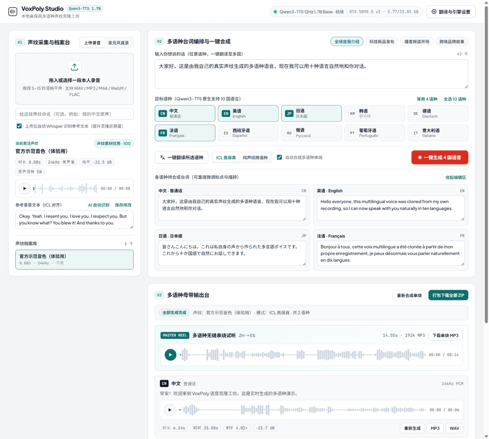

<div align="center">

# 🎙️ VoxPoly Studio V2.0 Pro

**Open-Source Multilingual Zero-Shot Voice Cloning, Long-Form Narration & One-Click Video Dubbing Studio**

[](./LICENSE)
[](#quick-start)
[](https://colab.research.google.com/github/zianxu78-ux/voxpoly-studio/blob/main/colab/VoxPoly_Colab.ipynb)

[简体中文](./README.md) · [English](./README_EN.md) · [Security & Responsible AI](./SECURITY.md)

<br/>



</div>

## Highlights

- **3 Conflict-Free Neural Engines (Isolated Workers + Auto VRAM Reclamation)**
  - **Qwen3-TTS 12Hz Base** (`1.7B` & low-VRAM `0.6B` switcher, Apache-2.0): 10 languages, ICL high-fidelity alignment, x-vector cross-lingual cloning, and **true batched long-form synthesis**.
  - **Chatterbox Multilingual V3** (MIT): **23 languages** (adding Arabic, Hindi, Turkish, Dutch, Polish, Nordic languages, Hebrew, Greek, Malay, Swahili) with `exaggeration` & `cfg_weight` controls.
  - **Fun-CosyVoice 3.0** (Apache-2.0): 9 languages, 18+ Chinese dialects, natural-language emotion/style instructions, and `[laughter]` / `[breath]` tags.
- **One-Click Multilingual Video Dubbing**
  - Upload `MP4 / MOV / WebM` → **Demucs (`htdemucs`)** vocal/BGM separation (with FFmpeg ducking fallback) → Whisper timestamped segmentation → auto speaker voiceprint extraction → duration-aware translation → pitch-preserving `atempo` sync → lossless MP4 muxing + bilingual & single-language `.srt` export.
- **Long-Form Smart Chunker + Live Chunk Preview**
  - Splits 500–8,000 char scripts cleanly on paragraph/sentence boundaries, levels loudness across chunks, and plays Chunk 1 while subsequent chunks finish generating.
- **Imperceptible Acoustic Watermark & Verifier**
  - Spread-spectrum watermark (`7.2–9.6 kHz`, survives 192kbps MP3 compression) embedded by default, paired with a built-in verification tab.
- **Broad Hardware Support**: NVIDIA RTX 50 (`cu128`), RTX 30/40/A100/L4 (`bf16+TF32`), RTX 20/16/T4 (auto `fp16`), **Apple Silicon M1–M4 (`MPS`)**, Linux AMD ROCm, and CPU fallback (`0.6B`).

## Quick Start

> Requirements: Python 3.10–3.12 and `ffmpeg` in PATH.

**Windows:**
```bat
git clone https://github.com/zianxu78-ux/voxpoly-studio.git
cd voxpoly-studio
install_windows.bat
start_windows.bat
```

**Linux / macOS (Apple Silicon supported):**
```bash
git clone https://github.com/zianxu78-ux/voxpoly-studio.git
cd voxpoly-studio
chmod +x install_linux_mac.sh start_linux_mac.sh
./install_linux_mac.sh            # Optional: --with-demucs --with-chatterbox --with-cosyvoice3 --all
./start_linux_mac.sh
```

Open `http://127.0.0.1:8765/` in your browser.

## Hardware Compatibility

| Accelerator | Typical Hardware | Support | Notes |
| :--- | :--- | :---: | :--- |
| NVIDIA Blackwell (`sm_120`) | RTX 5070 / 5080 / 5090 | ✅ Full | Auto `bf16 + TF32`, PyTorch `cu128` |
| NVIDIA Ampere / Ada / Hopper | RTX 30/40 series, L4, A100, H100 | ✅ Full | Auto `bf16 + TF32`, PyTorch `cu124`+ |
| NVIDIA Turing / Volta | RTX 20 series, GTX 1660, T4, V100 | ✅ Auto | Auto `fp16` fallback |
| Apple Silicon | M1 / M2 / M3 / M4 (16 GB+ RAM) | ✅ MPS | Auto `MPS` (`0.6B` recommended on 16 GB) |
| AMD Radeon (Linux) | RX 6000 / 7000 series | ✅ ROCm | Linux ROCm 6.2 + `sdpa` |
| CPU Only | Any modern x64/ARM64 CPU | ⚠️ Slow | Switch to `Qwen3 0.6B` in Settings |

## License & Responsible Use

Licensed under [Apache-2.0](./LICENSE). Please review [SECURITY.md](./SECURITY.md): only clone your own voice or voices for which you hold explicit, documented consent.
